# CMPC-libros — Plataforma de inventario de libros

Aplicación full-stack para digitalizar el inventario de la tienda CMPC-libros: autenticación JWT con dos perfiles
(administrador y usuario), CRUD de libros con imagen de portada, filtrado avanzado, ordenamiento por múltiples
campos, paginación del lado del servidor, búsqueda con debounce, exportación a CSV, soft delete y registro de
auditoría. Además incluye ventas con control de stock, administración de catálogos y usuarios, y un dashboard
con una vista distinta para cada perfil.

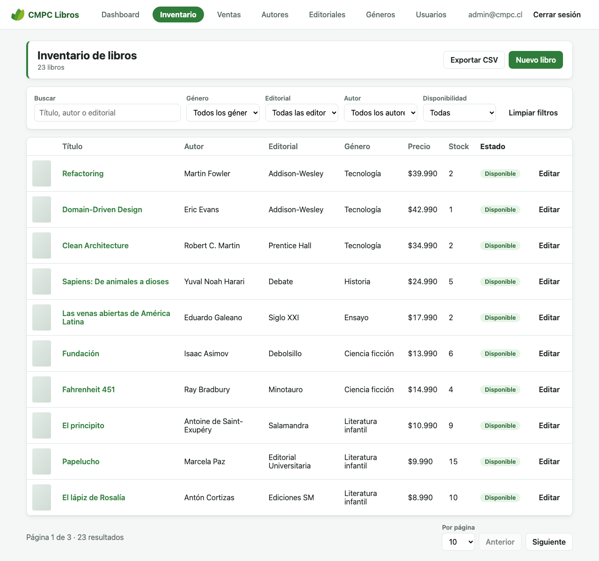

## Contenido

1. [Stack](#stack)
2. [Inicio rápido con Docker](#inicio-rápido-con-docker)
3. [Configuración](#configuración)
4. [Desarrollo local sin Docker](#desarrollo-local-sin-docker)
5. [Solución de problemas](#solución-de-problemas)
6. [Guía de uso](#guía-de-uso)
7. [Cumplimiento de requisitos](#cumplimiento-de-requisitos)
8. [Resumen de la API](#resumen-de-la-api)
9. [Arquitectura](#arquitectura)
10. [Decisiones de diseño](#decisiones-de-diseño)
11. [Logging y auditoría](#logging-y-auditoría)
12. [Supuestos](#supuestos)
13. [Testing](#testing)
14. [Calidad de código](#calidad-de-código)
15. [Mejoras fuera del alcance](#mejoras-fuera-del-alcance)

## Stack

| Capa          | Tecnologías                                                                               |
| ------------- | ----------------------------------------------------------------------------------------- |
| Frontend      | React 19 · TypeScript · Vite · React Router · TanStack Query · react-hook-form + zod      |
| Backend       | NestJS 11 · TypeScript · Passport JWT · class-validator · Swagger                         |
| Base de datos | PostgreSQL 16 · Prisma ORM (esquema declarativo, migraciones versionadas, cliente tipado) |
| Testing       | Jest · Vitest + Testing Library · Playwright (E2E)                                        |
| Calidad       | ESLint (máximo 60 líneas por archivo) · Prettier · Husky · lint-staged · commitlint       |
| Despliegue    | Imágenes Docker multi-stage · docker-compose · nginx                                      |

Monorepo con npm workspaces: `apps/api`, `apps/web` y `apps/e2e`, con un único `package-lock.json`.

## Inicio rápido con Docker

### Requisitos

- Docker Desktop (o Docker Engine con Compose v2) en ejecución.
- Puertos libres en el host: **8080** (web), **3000** (API) y **5433** (PostgreSQL).

### Levantar el stack

```bash
git clone https://github.com/gbo-ynz/cmpc-test.git
cd cmpc-test
cp .env.example .env          # opcional en local: sin .env se usan los valores por defecto del compose
docker compose up --build
```

El primer build tarda unos minutos. El stack está listo cuando la web responde en http://localhost:8080.

| Servicio          | URL                                                      |
| ----------------- | -------------------------------------------------------- |
| Aplicación web    | http://localhost:8080                                    |
| API               | http://localhost:3000/api                                |
| Swagger / OpenAPI | http://localhost:3000/api/docs                           |
| PostgreSQL        | `localhost:5433` (usuario `cmpc`, base `cmpc_libros`)    |
| Healthcheck       | http://localhost:3000/api/health (estado de API y de BD) |

Credenciales de demostración (una por perfil):

| Perfil        | Correo            | Contraseña    |
| ------------- | ----------------- | ------------- |
| Administrador | `admin@cmpc.cl`   | `Admin123!`   |
| Usuario       | `usuario@cmpc.cl` | `Usuario123!` |

### Datos de ejemplo

Al iniciar, el contenedor de la API aplica las migraciones (`prisma migrate deploy`) y ejecuta el seed, que
carga **23 libros de ejemplo** con stock: 8 géneros, 16 editoriales, 20 autores y 5 libros sin stock (no disponibles). Con el tamaño
de página por defecto son 3 páginas, suficiente para probar paginación, filtros y ordenamiento.

- El seed es **idempotente**: los libros se cargan solo si la tabla `books` está vacía, por lo que reiniciar
  el stack nunca duplica ni sobrescribe datos. Los dos usuarios de demostración se crean siempre (`upsert`).
- Los datos están en `apps/api/prisma/seed-data/books.js`; para modificarlos, edite ese archivo.

### Operación del stack

| Acción                                       | Comando                                               |
| -------------------------------------------- | ----------------------------------------------------- |
| Levantar en segundo plano                    | `docker compose up --build -d`                        |
| Ver el estado (incluye healthchecks)         | `docker compose ps`                                   |
| Ver logs de la API en vivo                   | `docker compose logs -f api`                          |
| Detener (conserva los datos)                 | `docker compose down`                                 |
| Volver al estado inicial (base vacía + seed) | `docker compose down -v && docker compose up --build` |
| Consola SQL sin instalar nada                | `docker compose exec db psql -U cmpc -d cmpc_libros`  |

> `down -v` elimina los volúmenes: todos los datos locales y las portadas subidas.

## Configuración

Hay dos archivos de ejemplo, uno por contexto. Ninguno contiene secretos reales y los `.env` están en
`.gitignore`.

### Docker (`.env` en la raíz, a partir de `.env.example`)

| Variable            | Por defecto               | Descripción                                                        |
| ------------------- | ------------------------- | ------------------------------------------------------------------ |
| `POSTGRES_PASSWORD` | `cmpc_local_password`     | Contraseña de PostgreSQL; también arma el `DATABASE_URL` de la API |
| `DB_HOST_PORT`      | `5433`                    | Puerto del host donde se publica PostgreSQL                        |
| `JWT_SECRET`        | valor solo para uso local | Clave de firma de los JWT (mínimo 32 caracteres)                   |

> Los valores por defecto del compose son **solo para uso local**. En cualquier entorno compartido defina
> `POSTGRES_PASSWORD` y `JWT_SECRET` propios (por ejemplo: `openssl rand -base64 48`).
>
> Lo mismo con las cuentas de demostración: sus contraseñas son públicas a propósito (están en este README
> y en los tests). Fuera de local, defina `SEED_ADMIN_PASSWORD` y `SEED_USER_PASSWORD` antes del primer
> arranque, porque el seed solo crea los usuarios cuando no existen.

### API fuera de Docker (`apps/api/.env`, a partir de `apps/api/.env.example`)

Se validan al iniciar (`src/config/env.validation.ts`): si falta una variable o es inválida, la API no
arranca y muestra el motivo.

| Variable                 | Por defecto             | Descripción                              |
| ------------------------ | ----------------------- | ---------------------------------------- |
| `DATABASE_URL`           | — (obligatoria)         | Cadena de conexión de PostgreSQL         |
| `JWT_SECRET`             | — (obligatoria)         | Clave de firma, mínimo 32 caracteres     |
| `JWT_EXPIRES_IN_SECONDS` | `3600`                  | Duración del token (mínimo 60)           |
| `PORT`                   | `3000`                  | Puerto HTTP                              |
| `NODE_ENV`               | `development`           | `development`, `production` o `test`     |
| `CORS_ORIGIN`            | `http://localhost:5173` | Orígenes permitidos (separados por coma) |
| `UPLOADS_DIR`            | `uploads`               | Carpeta de las portadas subidas          |
| `SEED_ADMIN_EMAIL`       | `admin@cmpc.cl`         | Usuario administrador creado por el seed |
| `SEED_ADMIN_PASSWORD`    | `Admin123!`             | Contraseña de ese usuario                |
| `SEED_USER_EMAIL`        | `usuario@cmpc.cl`       | Usuario con perfil "usuario" del seed    |
| `SEED_USER_PASSWORD`     | `Usuario123!`           | Contraseña de ese usuario                |

### Acceso a la base de datos

PostgreSQL se publica en el puerto **5433** del host (no en 5432) para no chocar con una instalación local
de PostgreSQL. Datos de conexión para DBeaver, TablePlus o DataGrip:

| Campo                | Valor                          |
| -------------------- | ------------------------------ |
| Host / Puerto        | `localhost` / `5433`           |
| Base de datos        | `cmpc_libros`                  |
| Usuario / Contraseña | `cmpc` / `cmpc_local_password` |

```sql
-- Libros, incluidos los eliminados (soft delete)
select title, stock, deleted_at from books order by created_at;

-- Últimas operaciones auditadas
select action, entity_type, entity_id, user_id, created_at from audit_logs order by created_at desc limit 20;
```

## Desarrollo local sin Docker

Las aplicaciones corren con Node y la base de datos sigue en Docker. Requisitos: Node ≥ 20 (ver `.nvmrc`).

```bash
npm install                                        # instala los workspaces y los hooks de git
docker compose up -d db                            # solo PostgreSQL
cp apps/api/.env.example apps/api/.env             # luego defina JWT_SECRET
npm run prisma:deploy -w apps/api && npm run prisma:seed -w apps/api
npm run start:dev -w apps/api                      # API en http://localhost:3000
npm run dev -w apps/web                            # UI en http://localhost:5173 (redirige /api a :3000)
```

### Scripts de la raíz

| Script                              | Qué hace                                                      |
| ----------------------------------- | ------------------------------------------------------------- |
| `npm run lint`                      | ESLint en todos los workspaces (falla ante cualquier warning) |
| `npm run typecheck`                 | `tsc --noEmit` en todos los workspaces                        |
| `npm test` / `npm run test:cov`     | Tests unitarios / con umbrales de cobertura (80%)             |
| `npm run test:int`                  | Tests de integración con PostgreSQL real (requiere Docker)    |
| `npm run test:e2e`                  | Tests E2E con Playwright (requiere el stack levantado)        |
| `npm run docker:up` / `docker:down` | Levantar / detener el stack completo                          |

## Solución de problemas

| Síntoma                                       | Causa y solución                                                                                                                                          |
| --------------------------------------------- | --------------------------------------------------------------------------------------------------------------------------------------------------------- |
| `Cannot connect to the Docker daemon`         | Docker no está en ejecución: inicie Docker Desktop.                                                                                                       |
| `port is already allocated` al levantar       | Otro proceso usa 8080, 3000 o 5433. Identifíquelo con `lsof -nP -iTCP:<puerto> -sTCP:LISTEN`. Para PostgreSQL puede cambiar el puerto con `DB_HOST_PORT`. |
| DBeaver responde `role "cmpc" does not exist` | Se está conectando a otro PostgreSQL local, no al contenedor: use el puerto **5433**.                                                                     |
| El login responde "Demasiados intentos"       | El login admite 5 intentos por minuto por IP (protección contra fuerza bruta). Espere un minuto.                                                          |
| No aparecen los 23 libros de ejemplo          | La base ya tenía libros y el seed no la modifica. Para empezar de cero: `docker compose down -v && docker compose up --build`.                            |
| Tras resetear la base, la app vuelve al login | Es lo esperado: el token guardado pertenece a un usuario que ya no existe y la API responde 401. Vuelva a iniciar sesión.                                 |

## Guía de uso

### 1. Iniciar sesión

Ingrese con las credenciales de demostración. Tras iniciar sesión, **todos los perfiles llegan primero al
dashboard**. Si intenta abrir una página protegida sin sesión (o la sesión venció a mitad de trabajo), la
aplicación lo lleva al login y, al autenticarse, lo devuelve a la página que había solicitado. La sesión dura
una hora; cuando expira, cualquier operación lo redirige al login.

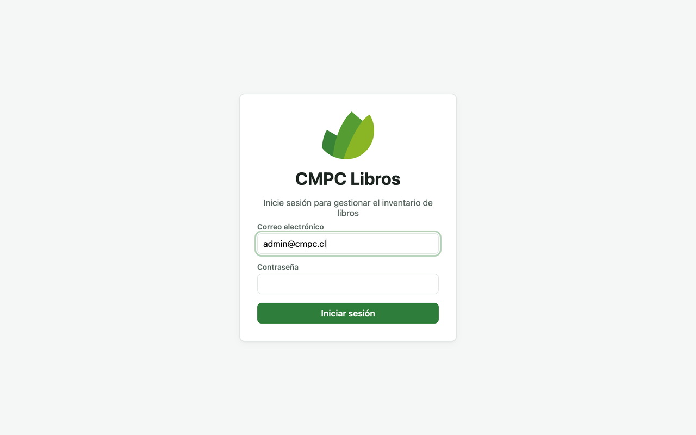

### 2. Inventario (`/books`)

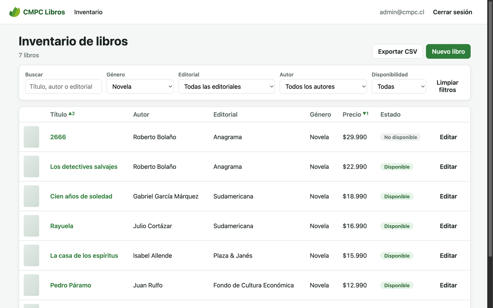

- **Buscar**: filtra por título, autor o editorial. La consulta se envía 400 ms después de dejar de escribir
  (debounce), no en cada tecla.
- **Filtros**: género, editorial, autor y disponibilidad; se combinan entre sí. Las listas solo ofrecen
  valores con al menos un libro activo, por lo que ningún filtro lleva a un resultado vacío.
- **Ordenar**: haga clic en un encabezado para alternar ascendente ▲ → descendente ▼ → sin orden. Haga clic en
  varias columnas para ordenar por múltiples campos; el número junto a la flecha indica la prioridad (en la
  imagen: precio descendente y, a igual precio, título ascendente).
- **Paginación**: en la parte inferior; tamaño de página de 10, 20 o 50. La paginación ocurre en el servidor.
- **Limpiar filtros**: restablece búsqueda, filtros y orden.
- **Exportar CSV**: descarga exactamente lo que se ve (mismos filtros y orden, sin paginar) como
  `libros-AAAA-MM-DD.csv`, en UTF-8 con BOM para que Excel muestre bien los acentos.

### 3. Crear o editar un libro

**Nuevo libro** (o **Editar** en el listado o en el detalle) abre el formulario:

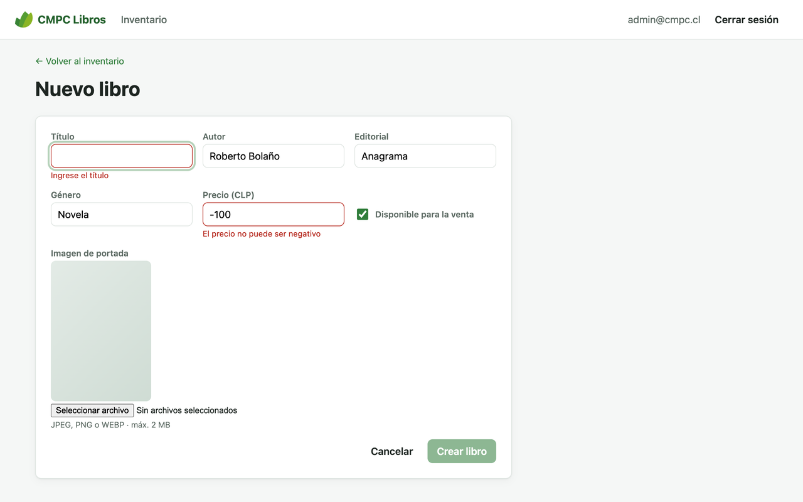

- Los campos se validan mientras se escribe y el botón de guardar se habilita solo cuando el formulario es
  válido y tiene cambios.
- Autor, editorial y género se **eligen de listas** con los registros existentes. Si falta uno, el administrador lo crea en su pantalla (Autores, Editoriales o Géneros).
- **Stock (unidades)**: un libro está disponible mientras tenga stock mayor que 0; no hay un "disponible" manual.
- **Imagen de portada** (opcional): JPEG, PNG o WEBP de hasta 2 MB, con vista previa. Al editar, subir una
  imagen nueva reemplaza la anterior.
- **Al crear**, la aplicación abre el detalle del libro nuevo.
- **Al editar** (desde el botón **Editar** del listado o del detalle), guardar **mantiene al usuario en
  "Editar libro"**: aparece "Los cambios se guardaron correctamente." y el formulario queda con los valores
  guardados, listo para seguir editando. El enlace superior, **← Volver al inventario**, regresa al listado.

### 4. Administrar autores, editoriales y géneros (solo administrador)

El menú de un administrador incluye **Autores**, **Editoriales** y **Géneros**. Cada pantalla lista los
registros con su cantidad de libros activos y permite agregar, editar y eliminar. Las tres usan la misma
estructura: tabla con paginación en el servidor, botones **Exportar CSV** y **Agregar**, y una pantalla propia para crear y editar.
**Exportar CSV** descarga _todos_ los registros del catálogo (no solo la página visible), ordenados por nombre.

- **Autores** tienen además fecha de nacimiento y una biografía breve (ambas opcionales). El lápiz abre
  **Editar autor**; al guardar se queda en la página con un mensaje, y **← Volver a autores** regresa al listado.
- **Editoriales** tienen además un país (opcional) y funcionan igual que autores: tabla con paginación en el
  servidor (Nombre, País, Libros activos, Acciones), **Agregar** abre **Nueva editorial** y el lápiz abre
  **Editar editorial** con los datos cargados.
- **Géneros** tienen además una descripción (opcional, hasta 500 caracteres) y funcionan igual: **Agregar** abre
  **Nuevo género** y el lápiz abre **Editar género** con los datos cargados.

- Los nombres no se repiten, sin distinguir mayúsculas ("Novela" y "novela" son el mismo).
- Un registro con libros asociados (incluso eliminados) no se puede eliminar.
- Un usuario con perfil "usuario" no ve estas secciones; si abre la URL, ve "No tiene permisos para ver
  esta página" (y la API responde 403).

### 5. Ver el detalle y eliminar

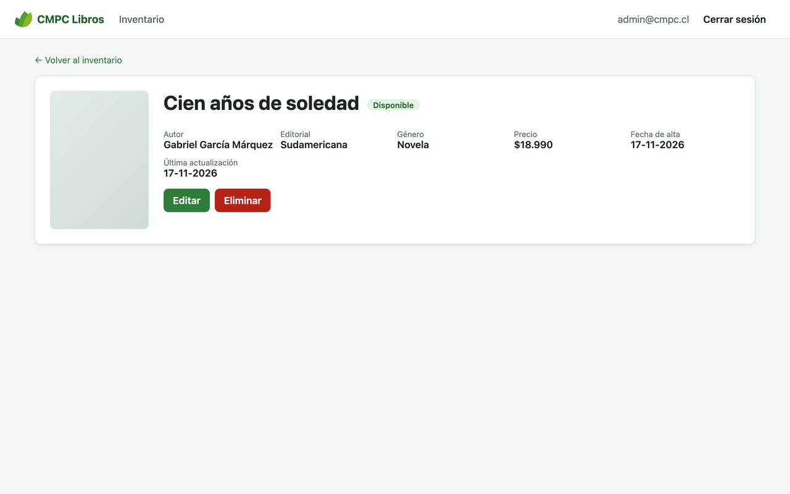

El detalle muestra todos los datos, la portada y las fechas de alta y última actualización. **Eliminar** pide
una confirmación en la misma pantalla. Es un **soft delete**: el libro desaparece de la aplicación, pero el
registro se conserva con `deleted_at` y la operación queda en `audit_logs`.

### 6. Dashboard (`/dashboard`)

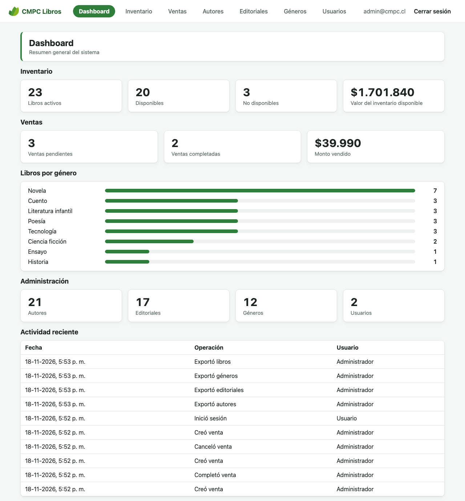

Es la primera pantalla tras iniciar sesión. Cada perfil ve cifras distintas:

- **Todos los perfiles**: libros activos, disponibles y no disponibles; libros por género (solo los géneros
  con libros); y ventas pendientes, ventas completadas y monto vendido.
- **Solo el administrador**: además, el valor del inventario disponible, la cantidad de autores, editoriales,
  géneros y usuarios (cada contador lleva a su pantalla) y las últimas 10 operaciones de auditoría.

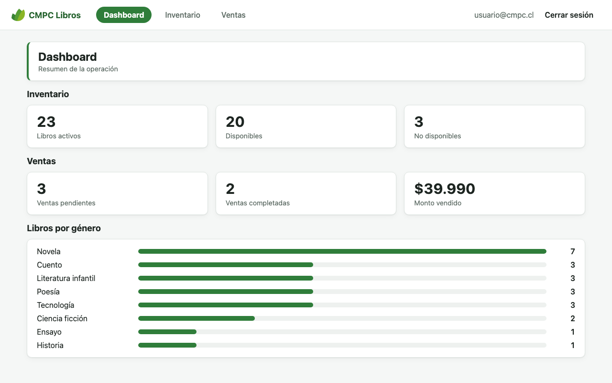

El recorte lo hace la **API**: a un usuario no le llega la sección de administración, no solo se oculta en la
pantalla. Las cifras se recalculan cada vez que se abre el dashboard.

### 7. Ventas (`/sales`, administrador y usuario)

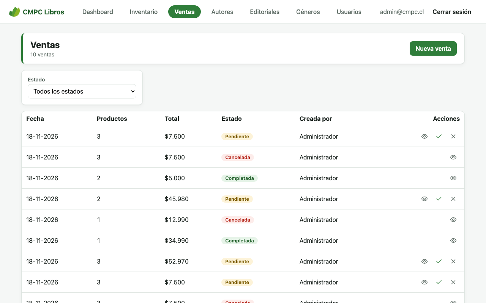

- **Listado**: paginación en el servidor y filtro por estado; muestra fecha, unidades (la suma de las
  cantidades), total, estado y quién la creó.
- **Nueva venta**: busque libros disponibles y agréguelos; la cantidad no puede superar el stock y un mismo libro
  no se repite en dos líneas. Cada línea guarda el precio del libro en ese momento. Al crearla se vuelve al
  listado y la venta queda **Pendiente**: todavía no se descuenta stock.
- **Acciones por fila**: el ojo abre el detalle; en una venta pendiente, el ✅ la completa y la ✖ la cancela.
  Completar abre un popup para elegir el método de pago y **Aceptar**; recién ahí se descuenta el stock de cada
  libro, en una sola transacción. Si algún libro no alcanza (o fue eliminado) se avisa y no se descuenta nada.
  Cancelar pide confirmación y no toca el stock. Una venta completada o cancelada es definitiva.

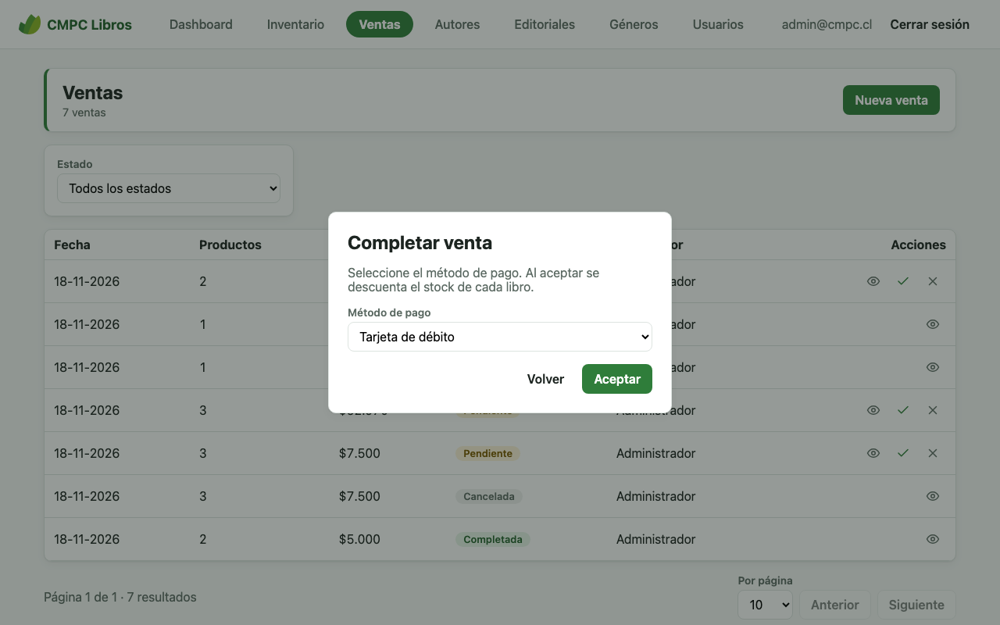

### 8. Administrar usuarios (solo administrador, `/users`)

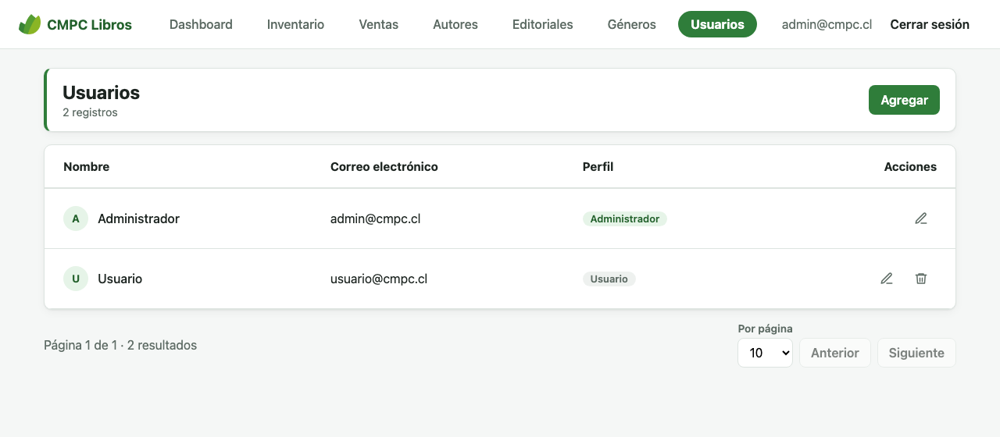

- Tabla con paginación en el servidor (Nombre, Correo electrónico, Perfil, Acciones). **Agregar** abre
  **Nuevo usuario** (nombre, correo único, perfil y contraseña de al menos 8 caracteres) y el lápiz abre
  **Editar usuario**; si la contraseña se deja vacía, se conserva la actual.
- **Eliminar** desactiva la cuenta: ya no puede iniciar sesión y su token deja de servir, pero su historial se
  conserva. El administrador en sesión no puede eliminarse ni quitarse su propio perfil, y siempre queda al menos
  un administrador activo.
- La contraseña se guarda con bcrypt y nunca se devuelve ni se registra en la auditoría.

## Cumplimiento de requisitos

Correspondencia entre el enunciado de la prueba y la implementación. Las rutas del frontend son relativas a
`apps/web/src/` y las del backend a `apps/api/src/`. Los criterios de aceptación de cada requisito y el test
que verifica cada uno están en **[docs/SPEC.md](docs/SPEC.md)**.

### Frontend (React + TypeScript)

| Requisito                                             | Implementación                                                                                 |
| ----------------------------------------------------- | ---------------------------------------------------------------------------------------------- |
| Login de autenticación                                | `features/auth/ui/LoginPage.tsx`, `LoginForm.tsx`                                              |
| Filtros por género, editorial, autor y disponibilidad | `features/books/ui/components/BookFiltersBar.tsx`                                              |
| Ordenamiento dinámico por múltiples campos            | `features/books/domain/sort.ts`, `ui/components/SortableHeader.tsx`                            |
| Paginación del lado del servidor                      | `shared/ui/Pagination.tsx` + `page`/`limit` en `GET /api/books`                                |
| Búsqueda en tiempo real con debounce                  | `shared/hooks/useDebouncedValue.ts`, `features/books/application/useBookListState.ts` (400 ms) |
| Validación reactiva de formularios                    | `features/books/domain/book-form.schema.ts` (zod) + `ui/components/BookForm.tsx` (`onChange`)  |
| Carga de una imagen por libro                         | `features/books/ui/components/ImagePicker.tsx` → `POST /api/books/:id/image`                   |
| Visualizar los datos de un libro                      | `features/books/ui/pages/BookDetailPage.tsx`, `ui/components/BookDetailCard.tsx`               |

### Backend (NestJS + TypeScript)

| Requisito                                | Implementación                                                                                                                                            |
| ---------------------------------------- | --------------------------------------------------------------------------------------------------------------------------------------------------------- |
| Arquitectura modular y escalable (SOLID) | Un módulo por bounded context (`modules/{auth,books,catalog,references,users,sales,dashboard,audit}`), DDD + hexagonal; ver [Arquitectura](#arquitectura) |
| Autenticación JWT                        | `modules/auth/` (`jwt.strategy.ts`, `jwt-auth.guard.ts` global, `@Public()` para las excepciones)                                                         |
| Endpoints RESTful para el CRUD de libros | `modules/books/presentation/books-query.controller.ts`, `books-command.controller.ts`                                                                     |
| Exportación de datos en CSV              | `GET /api/books/export` → `export-books-csv.use-case.ts`, `book-csv.serializer.ts` (streaming)                                                            |
| Soft delete                              | `Book.softDelete()` en `modules/books/domain/book.ts`; todas las consultas filtran `deleted_at IS NULL`                                                   |
| Logging para auditoría de operaciones    | Puerto `AuditLogger` → tabla `audit_logs` en la misma transacción; ver [Logging y auditoría](#logging-y-auditoría)                                        |

### Base de datos (PostgreSQL + Prisma)

| Requisito                                                 | Implementación                                                                                                             |
| --------------------------------------------------------- | -------------------------------------------------------------------------------------------------------------------------- |
| Prisma: esquema declarativo, migraciones y cliente tipado | `apps/api/prisma/schema.prisma`, `apps/api/prisma/migrations/`                                                             |
| Modelo normalizado con relaciones                         | `books` → `authors`, `publishers`, `genres` (N:1); `sale_items` → `sales`, `books`; `sales`, `audit_logs` → `users`        |
| Índices para consultas frecuentes                         | Compuestos `(deleted_at, <fk>)` y trigram (GIN) para la búsqueda de texto; detalle en [docs/DATABASE.md](docs/DATABASE.md) |
| Transacciones en operaciones críticas                     | `TransactionManager` con `AsyncLocalStorage` (`shared/infrastructure/prisma/prisma.service.ts`)                            |

### Testing, DevOps y documentación

| Requisito                                             | Implementación                                                                       |
| ----------------------------------------------------- | ------------------------------------------------------------------------------------ |
| Tests unitarios de componentes y servicios (frontend) | Vitest + Testing Library: 190 tests                                                  |
| Tests unitarios de servicios y controladores (NestJS) | Jest: 256 tests (más 54 de integración con PostgreSQL real)                          |
| Cobertura de al menos 80%                             | API 99,2% de líneas, web 95,7%; umbrales del 80% configurados en ambas apps          |
| `docker-compose.yml` para todo el stack               | `docker-compose.yml` (db + api + web con healthchecks)                               |
| README con instalación, uso y arquitectura            | Este documento                                                                       |
| Documentación de la API con Swagger/OpenAPI           | http://localhost:3000/api/docs                                                       |
| Diagrama de arquitectura                              | [Arquitectura](#arquitectura) y [docs/ARCHITECTURE.md](docs/ARCHITECTURE.md)         |
| Modelo relacional de la base de datos                 | [docs/DATABASE.md](docs/DATABASE.md) (Mermaid) y `docs/database.dbml` (dbdiagram.io) |

### Requerimientos adicionales

| Requisito                                 | Implementación                                                                                                                          |
| ----------------------------------------- | --------------------------------------------------------------------------------------------------------------------------------------- |
| Manejo de errores en el frontend          | `shared/api/api-error.ts` + `error-messages.ts` (mensajes por código), `ErrorBanner`, `RouteError`; un 401 lleva al login               |
| Manejo de errores en el backend           | `AllExceptionsFilter` + errores de dominio → contrato único `{ success: false, error: { code, message } }`; los 5xx no exponen detalles |
| Interceptores para transformar respuestas | `ResponseEnvelopeInterceptor` (`{ success, data, meta }`) y `RequestLoggingInterceptor`                                                 |

## Resumen de la API

Todas las respuestas usan el mismo formato: `{ success: true, data, meta? }` o
`{ success: false, data: null, error: { code, message, details? } }`.

| Método                | Endpoint                                                                                                    | Descripción                                                         |
| --------------------- | ----------------------------------------------------------------------------------------------------------- | ------------------------------------------------------------------- |
| POST                  | `/api/auth/login`                                                                                           | Credenciales → JWT (límite: 5 por minuto)                           |
| GET                   | `/api/auth/me`                                                                                              | Usuario actual                                                      |
| GET                   | `/api/books?search=&genreId=&publisherId=&authorId=&isAvailable=&sort=title:asc,price:desc&page=1&limit=10` | Listado paginado                                                    |
| GET                   | `/api/books/:id`                                                                                            | Detalle                                                             |
| POST                  | `/api/books`                                                                                                | Crear                                                               |
| PATCH                 | `/api/books/:id`                                                                                            | Actualización parcial                                               |
| DELETE                | `/api/books/:id`                                                                                            | Soft delete (204)                                                   |
| POST                  | `/api/books/:id/image`                                                                                      | Subir portada (`multipart/form-data`, campo `file`)                 |
| GET                   | `/api/books/export?<mismos filtros y orden>`                                                                | CSV en streaming                                                    |
| GET                   | `/api/catalog`                                                                                              | Autores, editoriales y géneros con libros activos (filtros)         |
| GET                   | `/api/authors` · `/api/publishers` · `/api/genres`                                                          | Todos los registros, con sus libros activos                         |
| GET                   | `/api/authors/export` · `/api/publishers/export` · `/api/genres/export`                                     | CSV con todos los registros del catálogo (solo administrador)       |
| GET                   | `/api/authors/:id`                                                                                          | Un autor con fecha de nacimiento y biografía                        |
| POST · PATCH · DELETE | `/api/authors[/:id]` (ídem `publishers`, `genres`)                                                          | Crear, editar, eliminar (solo administrador)                        |
| GET · POST            | `/api/users` · `/api/users/:id` · PATCH · DELETE                                                            | Usuarios paginados, crear, editar, desactivar (solo administrador)  |
| GET · POST            | `/api/sales?status=&page=1&limit=10` · `/api/sales/:id`                                                     | Ventas paginadas con filtro por estado, crear una venta pendiente   |
| POST                  | `/api/sales/:id/complete` · `/api/sales/:id/cancel`                                                         | Completar (descuenta stock, exige método de pago) o cancelar        |
| GET                   | `/api/dashboard`                                                                                            | Cifras principales; el administrador recibe además `administration` |
| GET                   | `/api/health`                                                                                               | Estado del servicio + chequeo de BD (público)                       |

Contrato completo con esquemas y ejemplos: Swagger en http://localhost:3000/api/docs.

## Arquitectura

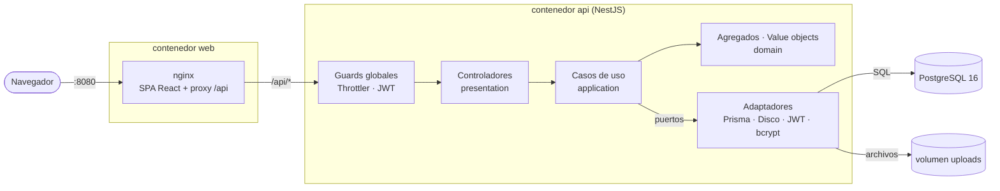

- **Backend: DDD + arquitectura hexagonal.** Cada bounded context tiene cuatro capas
  (`domain`, `application`, `infrastructure`, `presentation`) y las dependencias apuntan siempre hacia el
  dominio. Los casos de uso dependen de puertos (`abstract class`), nunca de Prisma.
- **Frontend: capas por feature.** `domain` (tipos y reglas puras) → `infrastructure` (cliente HTTP) →
  `application` (hooks de React Query) → `ui` (componentes presentacionales de ≤ 60 líneas).
- **Un solo origen:** nginx sirve la SPA y redirige `/api` a la API, sin CORS ni URL de la API en el bundle.

```
apps/
├── api/src/modules/<contexto>/{domain,application,infrastructure,presentation}
├── web/src/features/<feature>/{domain,infrastructure,application,ui}
└── e2e/{tests,support/pages}    Playwright: specs + Page Objects
docs/
├── SPEC.md           requisitos, criterios de aceptación y trazabilidad a los tests
├── ARCHITECTURE.md   capas, regla de dependencias, ciclo de vida de una petición, patrones
├── BUILD_GUIDE.md    cómo extender: catálogo de puertos, segregación de clases, regla de 60 líneas, testing
├── DATABASE.md       modelo ER, índices, transacciones, migraciones, portabilidad BD/ORM
├── database.dbml     modelo relacional para dbdiagram.io
└── screenshots/      capturas usadas en este README
```

## Decisiones de diseño

| Decisión                                                                                                                  | Fundamento                                                                                                                                                                                               |
| ------------------------------------------------------------------------------------------------------------------------- | -------------------------------------------------------------------------------------------------------------------------------------------------------------------------------------------------------- |
| Puertos como `abstract class`                                                                                             | Interfaz y token de inyección en uno; los casos de uso nunca ven Prisma.                                                                                                                                 |
| Agregado `Book` inmutable + value object `Price` (en centavos)                                                            | Invariantes en un solo lugar; dinero sin flotantes; sin mutaciones ocultas.                                                                                                                              |
| Transacciones con `AsyncLocalStorage`                                                                                     | Los casos de uso llaman a `transactions.run()` y los repositorios se suman automáticamente. Libro + auditoría se confirman de forma atómica.                                                             |
| Autores, editoriales y géneros administrados en sus propias pantallas; el libro los referencia por id                     | Un usuario sin perfil de administrador no puede crearlos "por la puerta de atrás" al guardar un libro; los filtros usan IDs estables.                                                                    |
| El catálogo de filtros solo incluye valores con libros activos                                                            | Ningún filtro lleva a un resultado vacío; se resuelve con `EXISTS`, cubierto por los índices `(deleted_at, <fk>)`.                                                                                       |
| Soft delete (`deleted_at`)                                                                                                | Facilita la auditoría, es reversible y todas las consultas lo filtran.                                                                                                                                   |
| Tabla de auditoría escrita dentro de la transacción de negocio                                                            | No existe registro de auditoría sin el cambio, ni cambio sin registro.                                                                                                                                   |
| El JWT se valida contra la base de datos en cada petición                                                                 | Una firma válida no basta: si el usuario fue eliminado, la API responde 401, y los cambios de rol aplican de inmediato (costo: una consulta por clave primaria).                                         |
| Controladores CQS (consulta / comando / imagen)                                                                           | Clases pequeñas y de un solo propósito (≤ 60 líneas).                                                                                                                                                    |
| Exportación CSV en streaming con protección contra inyección de fórmulas                                                  | Memoria constante; seguro de abrir en Excel.                                                                                                                                                             |
| Validación de imágenes por magic bytes y tamaño, nombres aleatorios, borrado protegido contra path traversal              | El MIME type lo controla el cliente.                                                                                                                                                                     |
| El stock se descuenta al **completar** la venta, con `UPDATE … WHERE stock >= n` por línea dentro de una transacción      | Dos ventas simultáneas nunca dejan stock negativo y, si una línea falla, se revierte todo. El estado de la venta también cambia con una condición (`PENDING`), así que solo una petición puede cerrarla. |
| Cada línea de venta guarda el precio unitario del momento                                                                 | Cambiar el precio de un libro nunca altera una venta pasada.                                                                                                                                             |
| El dashboard se recorta en la API según el perfil, y para un usuario ni siquiera se consultan los datos de administración | Ocultar cifras solo en la pantalla no protege nada: la respuesta nunca las contiene.                                                                                                                     |
| Los usuarios se desactivan, no se borran                                                                                  | La auditoría y las ventas conservan su autoría; el correo sigue ocupado.                                                                                                                                 |
| Despliegue en el mismo origen (nginx redirige `/api`)                                                                     | Sin CORS y sin URL de la API embebida en el bundle.                                                                                                                                                      |
| JWT en `localStorage`                                                                                                     | Simple para una prueba; contrapartida: exposición ante XSS. Camino a producción: cookie httpOnly `SameSite` + rotación de refresh tokens.                                                                |

## Logging y auditoría

Hay dos niveles, con propósitos distintos:

| Nivel                | Qué registra                                                                                                                                                            | Dónde se ve                                                                      |
| -------------------- | ----------------------------------------------------------------------------------------------------------------------------------------------------------------------- | -------------------------------------------------------------------------------- |
| Auditoría de negocio | Quién hizo qué y cuándo: `LOGIN`, `CREATE`, `UPDATE`, `DELETE`, `UPLOAD_IMAGE`, `EXPORT`, `COMPLETE`, `CANCEL`, con la entidad afectada y metadatos (nunca contraseñas) | Tabla `audit_logs` (ver [Acceso a la base de datos](#acceso-a-la-base-de-datos)) |
| Logging técnico      | Cada petición HTTP (método, ruta, código de estado y latencia) y los errores con su contexto                                                                            | `docker compose logs -f api` (stdout)                                            |

La auditoría de los cambios se escribe dentro de la misma transacción que la operación: si una falla,
ninguna de las dos se guarda. Los errores 5xx se registran completos en el log, pero al cliente solo se le
devuelve un mensaje genérico.

## Supuestos

- La disponibilidad se deriva del stock (`stock > 0`); no es un dato que se edite a mano.
- Un libro tiene exactamente un autor, una editorial y un género (el enunciado los menciona en singular).
- Los precios están en CLP con hasta 2 decimales.
- Hay dos perfiles: administrador (`ADMIN`) y usuario (`USER`). Las rutas de administración responden 403 a un usuario sin ese perfil, y el perfil se lee de la base en cada petición (ver la matriz de permisos en [docs/SPEC.md](docs/SPEC.md)).
- Una venta pendiente **no reserva stock**: dos ventas pueden pedir el último ejemplar y solo la primera en completarse lo consigue; la otra recibe un 409 al completar.
- Las ventas las ven y operan todos los usuarios autenticados (administrador y usuario), no solo quien las creó.
- Las imágenes se guardan en un volumen de Docker; un adaptador S3 implementaría el mismo puerto `ImageStorage`.
- No hay autorregistro: el enunciado pide solo login, y las cuentas las crean los administradores desde la pantalla de usuarios. El primer administrador lo crea el seed.

## Testing

| Suite                          | Tests | Cobertura (líneas)                                            |
| ------------------------------ | ----- | ------------------------------------------------------------- |
| API (Jest)                     | 256   | 99,2% (sentencias 98,1%; ramas 86,6%)                         |
| Web (Vitest + Testing Library) | 190   | 95,7% (ramas 93,7%)                                           |
| Integración (Testcontainers)   | 54    | Repositorios, índices, migraciones y seed sobre PostgreSQL 16 |
| E2E (Playwright, Chromium)     | 26    | Flujos críticos de todos los módulos                          |

Cada criterio de aceptación del enunciado está vinculado a su test en [docs/SPEC.md](docs/SPEC.md).

```bash
npm test               # unitarios de API y web
npm run test:cov       # con cobertura; falla si alguna métrica baja del 80%
```

De la cobertura unitaria están excluidos los DTOs, los módulos de Nest, `main` y el bootstrap, las utilidades
de test y los adaptadores de repositorio de Prisma: estos últimos son delgados y se prueban en la suite de
integración, contra un PostgreSQL real.

### Tests de integración

Levantan un PostgreSQL 16 efímero con Testcontainers, le aplican las **migraciones reales** y prueban lo que
un mock no puede garantizar:

```bash
npm run test:int       # requiere Docker en ejecución; no forma parte del pre-push
```

| Spec                                   | Qué verifica                                                                                                                                                                       |
| -------------------------------------- | ---------------------------------------------------------------------------------------------------------------------------------------------------------------------------------- |
| `prisma-catalog.repository.int-spec`   | El catálogo de filtros solo ofrece valores con libros activos                                                                                                                      |
| `database-indexes.int-spec`            | La migración crea los índices y PostgreSQL los usa (planes medidos sobre 2.000 libros con `ANALYZE`)                                                                               |
| `seed.int-spec`                        | El seed carga 23 libros, es idempotente y nunca sobrescribe datos existentes                                                                                                       |
| `migrations.int-spec`                  | Las migraciones conservan los datos ya escritos (el rol `EDITOR` pasa a `USER`, el stock se calcula desde la disponibilidad), rechazan stock negativo y crean las tablas de ventas |
| `sales-indexes.int-spec`               | El listado de ventas y el filtro "libros con stock" usan sus índices compuestos (planes con `EXPLAIN`)                                                                             |
| `prisma-sale-stock.int-spec`           | Dos descuentos simultáneos sobre el último ejemplar: solo uno se aplica; si una línea no tiene stock, se revierte toda la venta                                                    |
| `prisma-dashboard.repository.int-spec` | Cifras del dashboard: libros eliminados, sin stock, ventas canceladas y usuarios desactivados no cuentan; `SUM(precio × stock)` con decimales                                      |
| `prisma-*.repository.int-spec` (resto) | Autores, editoriales, géneros, usuarios y ventas: orden, paginación, mayúsculas y reglas de borrado                                                                                |

El rate limiting y los headers de seguridad se prueban levantando el `AppModule` real con `supertest`
(`http-security.spec.ts`), dentro de la suite unitaria.

### Tests E2E

Recorren la aplicación como un usuario, contra el stack de Docker (`http://localhost:8080`):

```bash
docker compose up --build -d                  # el stack debe estar levantado
npx -w apps/e2e playwright install chromium   # solo la primera vez
npm run test:e2e                              # informe HTML: npm run e2e:report -w apps/e2e
```

| Spec                                     | Qué verifica                                                                                                                     |
| ---------------------------------------- | -------------------------------------------------------------------------------------------------------------------------------- |
| `auth.setup.ts`                          | Login real; tras autenticarse vuelve a la página protegida solicitada                                                            |
| `auth.spec.ts`                           | Redirección sin sesión, validación del formulario, credenciales inválidas, logout                                                |
| `book-lifecycle.spec.ts`                 | Validación reactiva → alta con portada → detalle → soft delete → el género sale del filtro                                       |
| `book-edit.spec.ts`                      | Editar desde el listado y desde el detalle: guardar mantiene la pantalla, confirma y vuelve al inventario                        |
| `book-list.spec.ts`                      | Filtros combinados, búsqueda con debounce (1 request), orden multi-campo, paginación                                             |
| `book-export.spec.ts`                    | El CSV descargado contiene exactamente las filas filtradas                                                                       |
| `admin.spec.ts`                          | Géneros (alta, edición, baja y regla de libros asociados) y perfiles: un usuario ve el dashboard operativo, no la administración |
| `authors.spec.ts` · `publishers.spec.ts` | Alta con los datos propios (biografía, país), edición y baja desde la interfaz                                                   |
| `catalog-export.spec.ts`                 | Exportar CSV de autores, editoriales y géneros                                                                                   |
| `users.spec.ts`                          | Un usuario creado inicia sesión; al eliminarlo, su token deja de servir                                                          |
| `sales.spec.ts`                          | Crear una venta vuelve al listado; completar descuenta stock; cancelar no; libro eliminado → 409 sin descontar                   |
| `dashboard.spec.ts`                      | El administrador aterriza en el dashboard y las cifras siguen a los datos reales                                                 |

Decisiones:

- **Una sola sesión por corrida:** el login está limitado a 5 intentos por minuto. El setup guarda la sesión
  y la reutiliza mientras la API la acepte (`/api/auth/me`), en lugar de relajar el límite para los tests.
- **Datos aislados:** cada corrida crea sus libros (vía API) bajo un género único y los elimina al terminar;
  las aserciones siempre se hacen a través de la interfaz.
- **Un worker:** todos los specs comparten la misma base de datos.
- Variables opcionales: `E2E_BASE_URL`, `E2E_USER_EMAIL` y `E2E_USER_PASSWORD` (administrador), `E2E_REGULAR_EMAIL` y `E2E_REGULAR_PASSWORD` (usuario).
- **Si cambia la contraseña de un usuario de demostración desde la pantalla de usuarios**, el e2e de ese perfil falla al iniciar sesión: vuelva a dejarla como estaba o pase la nueva con esas variables.
- Las listas del admin paginan en el servidor y los datos de corridas anteriores se acumulan, por lo que los specs de catálogos recorren las páginas hasta encontrar la fila (`support/paged-table.ts`).

## Calidad de código

| Herramienta        | Regla                                                                                                                                  |
| ------------------ | -------------------------------------------------------------------------------------------------------------------------------------- |
| ESLint             | Máximo **60 líneas** por archivo y sin `console` en todos los workspaces; en API y web, además, funciones cortas y complejidad acotada |
| Prettier           | Formato único para TypeScript, JSON, Markdown, YAML y CSS                                                                              |
| Husky `pre-commit` | lint-staged (ESLint + Prettier sobre los archivos modificados) y `typecheck` de todo el monorepo                                       |
| Husky `commit-msg` | commitlint: mensajes en formato Conventional Commits                                                                                   |
| Husky `pre-push`   | Tests unitarios de todos los workspaces                                                                                                |

La guía para extender la aplicación respetando estas reglas está en [docs/BUILD_GUIDE.md](docs/BUILD_GUIDE.md).

## Mejoras fuera del alcance

- Tests de integración de los repositorios Prisma de libros y de auditoría, y ejecución del E2E en un stack aislado y efímero (hoy comparte la base y los puertos del stack local).
- Refresh tokens en cookies httpOnly. Reserva de stock al crear una venta pendiente (hoy solo se descuenta al completar).
- Reactivación de libros eliminados (el soft delete ya conserva los datos necesarios).
- Adaptador `ImageStorage` compatible con S3 + redimensionamiento de imágenes.
- Paginación por keyset para exportaciones de catálogos muy grandes; particionado de la tabla de auditoría.
- Actualizar `prisma` a 7.x y `zod` a 4.x: `npm audit --omit=dev` reporta 4 avisos de severidad alta (agotamiento de memoria al validar colecciones enormes con `zod`, que aquí solo valida campos de formulario; y agotamiento de pila en `deepmerge-ts`, usado por la configuración del CLI de Prisma). El riesgo en este uso es bajo, pero ambas correcciones son saltos de versión mayor y conviene hacerlas con su propia verificación.
- Pipeline de CI (GitHub Actions): lint → typecheck → test → E2E → build de imágenes.
