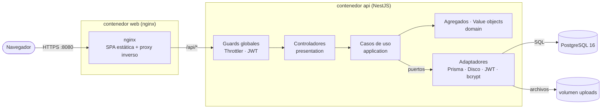
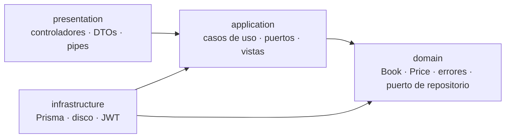
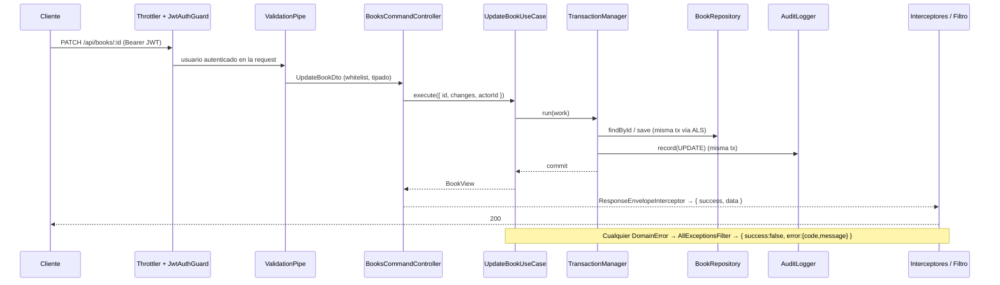

# Arquitectura

## 1. Vista general del sistema



- **Un solo origen**: nginx sirve la SPA y redirige `/api` → sin CORS en producción y sin URL de la API embebida en el bundle.
- **API sin estado**: autenticación JWT e imágenes en un volumen detrás de un puerto → escalable horizontalmente (reemplazar el adaptador de disco por S3 para escalar a más de un nodo).
- **Migraciones al iniciar**: el contenedor de la API ejecuta `prisma migrate deploy` + seed idempotente antes de levantar.

## 2. Backend: DDD + hexagonal (puertos y adaptadores)

```
src/
├── main.ts / app.module.ts        composition root
├── bootstrap/                     configuración HTTP (prefijo, helmet, CORS, pipes, Swagger)
├── config/                        validación de variables de entorno (fail fast)
├── shared/
│   ├── domain/                    jerarquía de DomainError, paginación, AuthenticatedUser
│   ├── application/               puertos transversales: TransactionManager, AuditLogger
│   └── infrastructure/            Prisma (transacciones con ALS), interceptores, filtro, decoradores
└── modules/                       una carpeta por bounded context
    ├── books/   domain · application · infrastructure · presentation
    ├── catalog/ domain · application · infrastructure · presentation
    ├── auth/    domain · application · infrastructure · presentation
    └── audit/   infrastructure (implementa el puerto compartido AuditLogger)
```

### La regla de dependencias



Las flechas apuntan **hacia adentro**. El dominio no importa nada de NestJS, Prisma ni Express
(la única concesión al framework es `@Injectable()` en los casos de uso, aceptada por comodidad de la inyección de dependencias).

| Capa            | Contiene                                                                                                                                  | No debe                                                               |
| --------------- | ----------------------------------------------------------------------------------------------------------------------------------------- | --------------------------------------------------------------------- |
| Dominio         | Agregado `Book` (inmutable), VO `Price`, invariantes, puerto `BookRepository`, errores de dominio                                         | Conocer HTTP, SQL o Nest                                              |
| Aplicación      | Una clase por caso de uso, puertos (`ImageStorage`, `TransactionManager`, `AuditLogger`), vistas de salida (`BookView`), serializador CSV | Devolver objetos de dominio a los controladores ni manejar temas HTTP |
| Infraestructura | Adaptadores que implementan puertos, mappers registro↔agregado, constructores de consultas                                                | Contener reglas de negocio                                            |
| Presentación    | Controladores, validación de DTOs, parseo de queries, validación de archivos                                                              | Contener reglas de negocio ni usar Prisma                             |

### Ciclo de vida de una petición



### Aspectos transversales

| Aspecto                 | Implementación                                                                                                    |
| ----------------------- | ----------------------------------------------------------------------------------------------------------------- |
| Autenticación           | `JwtAuthGuard` global (`APP_GUARD`); se excluye una ruta con `@Public()`                                          |
| Fuerza bruta            | `ThrottlerGuard` global (120 req/min); login limitado a 5 req/min                                                 |
| Validación              | `ValidationPipe` global (`whitelist`, `forbidNonWhitelisted`, `transform`) + invariantes de dominio               |
| Formato de respuesta    | `ResponseEnvelopeInterceptor` → `{ success, data, meta? }` (omite los streams de archivos)                        |
| Log de acceso           | `RequestLoggingInterceptor` → método, URL, status y latencia                                                      |
| Auditoría               | Puerto `AuditLogger` → tabla `audit_logs` (misma transacción) + log estructurado en stdout                        |
| Errores                 | `AllExceptionsFilter` + `resolveError` → un único contrato de error; los detalles de errores 5xx nunca se exponen |
| Headers de seguridad    | `helmet`                                                                                                          |
| Soft delete             | `Book.softDelete()` + `deleted_at IS NULL` en todas las consultas                                                 |
| Documentación de la API | Swagger en `/api/docs`                                                                                            |

### Patrones de diseño utilizados

| Patrón                                  | Dónde                                                   | Por qué                                                                                               |
| --------------------------------------- | ------------------------------------------------------- | ----------------------------------------------------------------------------------------------------- |
| Aggregate root + value object           | `Book`, `Price`                                         | Invariantes en un solo lugar; dinero sin flotantes                                                    |
| Repository                              | `BookRepository`, `CatalogRepository`, `UserRepository` | El dominio ignora el ORM                                                                              |
| Puertos y adaptadores                   | cada puerto `abstract class`                            | Cambiar infraestructura sin tocar casos de uso (las clases abstractas sirven además como token de DI) |
| Unit of work                            | `TransactionManager` + `AsyncLocalStorage`              | Transacciones sin propagar `tx` por las firmas                                                        |
| Caso de uso / command handler           | una clase por operación                                 | SRP, testeo trivial                                                                                   |
| CQS                                     | `BooksQueryController` vs `BooksCommandController`      | Lecturas y escrituras evolucionan de forma independiente                                              |
| Mapper                                  | `book.mapper.ts`, `toBookView`                          | Los modelos de persistencia y de transporte nunca se filtran                                          |
| Objeto de consulta (tipo specification) | `BookCriteria` + `book-query.builder.ts`                | Los filtros son datos de dominio; el SQL es un detalle del adaptador                                  |
| Acción compensatoria                    | `UploadBookImageUseCase`                                | El almacenamiento de archivos no es transaccional; se deshace si falla                                |
| Streaming                               | Export CSV con async generator → `StreamableFile`       | Memoria constante para cualquier tamaño de catálogo                                                   |

## 3. Frontend: capas por feature + hexagonal liviano

```
src/
├── app/                 composition root: providers, router, AuthenticatedLayout (container)
├── shared/              transversal: cliente HTTP, errores, sesión, hooks, kit de UI
└── features/
    ├── auth/            domain · infrastructure · application · ui
    └── books/
        ├── domain/          tipos, puerto BooksGateway, esquema zod, reglas de orden (puro)
        ├── infrastructure/  booksApi (adaptador axios), mapper de query params
        ├── application/     hooks de React Query, query keys, estado del listado (debounce)
        └── ui/              páginas (puntos de entrada de rutas) + componentes (≤ 60 líneas cada uno)
```

| Regla                                                        | Ejemplo                                                                      |
| ------------------------------------------------------------ | ---------------------------------------------------------------------------- |
| La lógica pura vive en `domain/` y no importa React          | `toggleSort`, `bookFormSchema`, `validateImage`                              |
| Los componentes nunca llaman a axios; llaman a hooks         | `BooksListPage` → `useBookList` → `booksApi.list`                            |
| Estado del servidor = React Query; estado de UI = `useState` | `useBookListState` maneja filtros/orden/página; React Query maneja los datos |
| Presentacional vs container                                  | `AppLayout` (solo props) vs `AuthenticatedLayout` (conecta auth + caché)     |
| Errores normalizados una sola vez                            | interceptor de axios → `ApiError` → `ErrorBanner`                            |
| Expiración de sesión                                         | cualquier 401 → `SESSION_EXPIRED_EVENT` → `AuthProvider.logout()`            |

### Decisiones de rendimiento

- Paginación, filtros y ordenamiento en el servidor; `keepPreviousData` evita el parpadeo de la tabla.
- Búsqueda con debounce (400 ms) → una petición por palabra, no por tecla (cubierto por un test).
- Code splitting por ruta para las páginas de alta/edición/detalle + chunks de vendors (`react`, `data`, `forms`).
- `BookRow` está memoizado; las imágenes usan `loading="lazy"` con dimensiones fijas (sin layout shift).
- Catálogo en caché 5 minutos; los errores 4xx no se reintentan.
