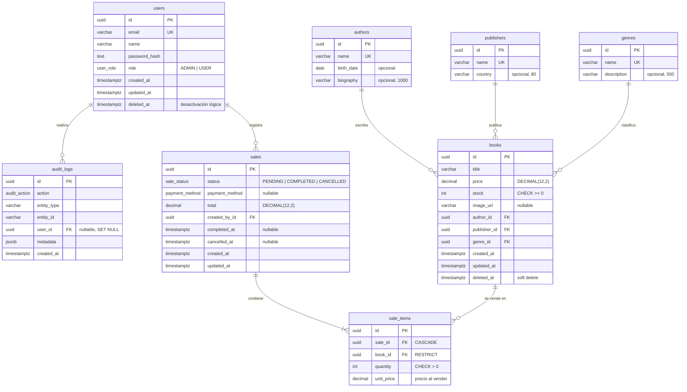

# Base de datos: modelo, migraciones y portabilidad

> Fuente de verdad: [`apps/api/prisma/schema.prisma`](../apps/api/prisma/schema.prisma).
> Versión para dbdiagram.io: [`database.dbml`](./database.dbml).

## 1. Modelo relacional

### Decisiones de normalización

| Decisión                                                      | Por qué                                                                                                                                                                    |
| ------------------------------------------------------------- | -------------------------------------------------------------------------------------------------------------------------------------------------------------------------- |
| `authors`, `publishers` y `genres` son tablas separadas (3FN) | Los filtros usan IDs estables, no hay variaciones de escritura ("G. García Márquez" vs "Gabriel García Márquez") y el endpoint de catálogo es un `SELECT id, name` barato. |
| Un autor por libro (`author_id`)                              | El enunciado menciona un único "autor". Una tabla muchos-a-muchos `book_authors` es la evolución documentada (ver §5).                                                     |
| `price DECIMAL(12,2)` + value object `Price` en centavos      | El dinero nunca es un flotante.                                                                                                                                            |
| `deleted_at` en lugar de `DELETE`                             | Soft delete: auditoría, posibilidad de deshacer, historial referencial. Toda lectura filtra `deleted_at IS NULL`.                                                          |
| `ON DELETE RESTRICT` en las referencias del libro             | Un autor no puede desaparecer mientras haya libros que lo referencien.                                                                                                     |
| `audit_logs.user_id ON DELETE SET NULL`                       | El registro de auditoría sobrevive a la eliminación de usuarios.                                                                                                           |
| `users.deleted_at` en lugar de `DELETE`                       | Borrar un usuario dejaría `user_id = NULL` en su auditoría y se perdería quién hizo cada operación. Login y validación del token ignoran a los usuarios con `deleted_at`.  |
| `stock` con `CHECK (stock >= 0)`                              | La última defensa contra stock negativo es la base: ninguna ruta de código (ni dos ventas simultáneas) puede violarla.                                                     |
| `sale_items.unit_price` copia el precio al vender             | Cambiar el precio de un libro nunca altera una venta pasada.                                                                                                               |
| `CHECK` de coherencia en `sales`                              | Completada ⇔ tiene método de pago y fecha de cierre; cancelada ⇔ tiene fecha de cancelación. Un estado imposible no puede guardarse.                                       |
| Claves primarias UUID generadas por el dominio                | El agregado tiene identidad antes de persistirse (sin ida y vuelta), es seguro exponerlas en URLs y facilitan la fusión entre entornos.                                    |

### Índices (y la consulta que atiende cada uno)

| Índice                                                                                                        | Consulta que atiende                                                                                                                                                                                                                                                                                          |
| ------------------------------------------------------------------------------------------------------------- | ------------------------------------------------------------------------------------------------------------------------------------------------------------------------------------------------------------------------------------------------------------------------------------------------------------- |
| `(deleted_at, genre_id)` / `(deleted_at, publisher_id)` / `(deleted_at, author_id)`                           | Filtros del listado, siempre combinados con el predicado de soft delete.                                                                                                                                                                                                                                      |
| `(deleted_at, created_at)`                                                                                    | Orden por defecto (más recientes primero) + paginación.                                                                                                                                                                                                                                                       |
| `price`                                                                                                       | Ordenamiento por precio.                                                                                                                                                                                                                                                                                      |
| GIN `gin_trgm_ops` en `books.title`, `authors.name`, `publishers.name`                                        | Búsqueda de texto libre (`ILIKE '%término%'`): un B-tree no puede atender un comodín inicial; un GIN de trigramas sí.                                                                                                                                                                                         |
| `audit_logs (entity_type, entity_id)` / `(user_id, created_at)`                                               | "Historial de este libro" y "qué hizo este usuario".                                                                                                                                                                                                                                                          |
| `(deleted_at, stock)`                                                                                         | Filtro de disponibilidad (`stock > 0`).                                                                                                                                                                                                                                                                       |
| `sales (status, created_at)` / `(created_at)`                                                                 | Listado de ventas filtrado por estado y ordenado por fecha.                                                                                                                                                                                                                                                   |
| `books_active_identity_key`: único parcial `(lower(title), author_id, publisher_id) WHERE deleted_at IS NULL` | Un libro no se repite entre los activos (mismo título sin importar mayúsculas, autor y editorial); uno eliminado no bloquea volver a cargarlo. Es un índice de expresión parcial que Prisma no representa en `schema.prisma`: vive solo en la migración, y `prisma migrate diff` no lo marca como diferencia. |
| `sale_items (sale_id, book_id)` único / `(book_id)`                                                           | Un libro aparece una sola vez por venta; "ventas de este libro".                                                                                                                                                                                                                                              |

Los planes de ejecución (`EXPLAIN` sobre 2.000 filas con `ANALYZE`) están verificados con tests de integración:
`database-indexes.int-spec.ts` para libros y `sales-indexes.int-spec.ts` para ventas y disponibilidad. El `SUM(precio × stock)`
del dashboard recorre los libros con stock (una pasada); no necesita índice propio con este volumen.

## 2. Transacciones

Los casos de uso llaman al puerto `TransactionManager`; el adaptador de Prisma abre un `$transaction`
interactivo y guarda el cliente de la transacción en `AsyncLocalStorage`.
Los repositorios siempre consultan a través de `prisma.db`, por lo que **cada llamada a un repositorio dentro
de `run()` se suma a la misma transacción sin pasar un argumento `tx`**.

Operaciones críticas envueltas en una transacción:

| Operación                                      | Sentencias que se confirman o revierten juntas                                                                                                                                                        |
| ---------------------------------------------- | ----------------------------------------------------------------------------------------------------------------------------------------------------------------------------------------------------- |
| Crear libro                                    | insert del libro (autor, editorial y género existentes, por id) + insert de auditoría                                                                                                                 |
| Actualizar libro                               | lectura del libro + update del libro + insert de auditoría                                                                                                                                            |
| Eliminar libro                                 | lectura del libro + asignación de `deleted_at` + insert de auditoría                                                                                                                                  |
| Subir imagen                                   | update de `image_url` + insert de auditoría (el archivo se elimina si falla la escritura en BD — compensación)                                                                                        |
| Crear venta                                    | lectura de los libros vendibles + insert de la venta y sus líneas (con el precio copiado) + insert de auditoría                                                                                       |
| Completar venta                                | lectura de la venta + por cada línea `UPDATE books SET stock = stock - n WHERE stock >= n` + cambio de estado condicionado a `PENDING` + auditoría. Si una línea no tiene stock, **se revierte todo** |
| Cancelar venta                                 | cambio de estado condicionado a `PENDING` + insert de auditoría (el stock no se toca)                                                                                                                 |
| Crear, editar o desactivar usuario / catálogos | lectura + escritura + insert de auditoría; la contraseña nunca se guarda en la auditoría                                                                                                              |

## 3. Flujo de migraciones

| Situación                      | Comando                                                                                    | Notas                                                                                                          |
| ------------------------------ | ------------------------------------------------------------------------------------------ | -------------------------------------------------------------------------------------------------------------- |
| Cambiar el modelo en local     | `npm run prisma:migrate -w apps/api -- --name <cambio>`                                    | Genera el SQL en `prisma/migrations/<timestamp>_<cambio>/` y lo aplica. **Revisar el SQL antes de commitear.** |
| CI / contenedores / producción | `npx prisma migrate deploy`                                                                | Solo aplica migraciones commiteadas, nunca genera. Se ejecuta automáticamente en `docker-entrypoint.sh`.       |
| Generar SQL sin base de datos  | `npx prisma migrate diff --from-empty --to-schema-datamodel prisma/schema.prisma --script` | Así se generó la migración inicial.                                                                            |
| Seed                           | `npm run prisma:seed -w apps/api`                                                          | Idempotente (upserts), seguro en cada arranque.                                                                |

### Regla para cero downtime: expandir → migrar → contraer

Nunca renombrar ni eliminar una columna en la misma versión que deja de usarla.

1. **Expandir**: agregar la nueva columna/tabla (nullable o con valor por defecto). Desplegar código que escriba en ambas.
2. **Migrar**: completar los datos por lotes (`UPDATE ... WHERE id IN (...)`), fuera del flujo de las peticiones.
3. **Contraer**: cuando ningún código lea la columna antigua, eliminarla en una versión posterior.

Índices grandes en producción: crearlos con `CREATE INDEX CONCURRENTLY` en una migración editada a mano
(Prisma permite editar el SQL generado antes de aplicarlo).

### Historial de migraciones

| Migración                                   | Qué hace                                                                                                                                                         | Cómo se verificó                                                                                                                                                                                     |
| ------------------------------------------- | ---------------------------------------------------------------------------------------------------------------------------------------------------------------- | ---------------------------------------------------------------------------------------------------------------------------------------------------------------------------------------------------- |
| `20261117000000_init`                       | Modelo inicial, `pg_trgm` e índices                                                                                                                              | `database-indexes.int-spec.ts`                                                                                                                                                                       |
| `20261118000000_roles_stock_sales_expand`   | **Expandir**: `EDITOR` → `USER`, `users.deleted_at`, `books.stock` (calculado desde `is_available`), tablas `sales` y `sale_items`, acciones `COMPLETE`/`CANCEL` | `migrations.int-spec.ts` (datos escritos con el esquema inicial sobreviven) + `prisma migrate diff`: sin diferencias con el schema                                                                   |
| `20261118010000_drop_is_available_contract` | **Contraer**: elimina `books.is_available` y su índice; la disponibilidad pasa a ser `stock > 0`                                                                 | `migrations.int-spec.ts` › "drops is_available once stock replaces it" + `prisma migrate diff` sin diferencias                                                                                       |
| `20261118020000_author_details`             | Agrega `authors.birth_date` (`DATE`) y `authors.biography` (`VARCHAR(1000)`), ambas opcionales: aditiva, las filas existentes siguen válidas sin relleno         | `prisma-author.repository.int-spec.ts` (la fecha vuelve igual, sin corrimiento horario) + `migrations.int-spec.ts`                                                                                   |
| `20261118120000_publisher_country`          | Agrega `publishers.country` (`VARCHAR(80)`), opcional: aditiva, las filas existentes siguen válidas sin relleno                                                  | `prisma-publisher.repository.int-spec.ts` + `migrations.int-spec.ts`                                                                                                                                 |
| `20261118130000_genre_description`          | Agrega `genres.description` (`VARCHAR(500)`), opcional: aditiva, las filas existentes siguen válidas sin relleno                                                 | `prisma-genre.repository.int-spec.ts` + `migrations.int-spec.ts`                                                                                                                                     |
| `20261119000000_unique_active_book`         | Normaliza los títulos (espacios), **se detiene si hay libros activos duplicados** y crea el índice único parcial `books_active_identity_key`                     | `prisma-book.repository.int-spec.ts`; verificado además a mano: con duplicados la migración falla con un mensaje claro y, tras eliminar la copia y `prisma migrate resolve --rolled-back`, se aplica |

La segunda migración se escribió a mano porque Prisma traduce el renombre de un valor de enum como "borrar y
recrear", lo que perdería los usuarios con ese rol; `ALTER TYPE … RENAME VALUE` conserva cada fila. Después
de editar a mano, `prisma migrate diff --from-migrations … --to-schema-datamodel …` debe responder
`No difference detected`. La fase de **contraer** llegó en la migración siguiente, cuando ningún código leía ya `is_available`.

## 4. Portabilidad: ¿qué tan difícil es cambiar la base de datos o el ORM?

Las capas de dominio y aplicación **nunca importan `@prisma/client`**. La persistencia vive detrás de
cinco puertos, cada uno con exactamente un adaptador de Prisma:

| Puerto (aplicación/dominio) | Adaptador Prisma (infraestructura)                                  |
| --------------------------- | ------------------------------------------------------------------- |
| `BookRepository`            | `PrismaBookRepository` + `book.mapper.ts` + `book-query.builder.ts` |
| `CatalogRepository`         | `PrismaCatalogRepository`                                           |
| `UserRepository`            | `PrismaUserRepository`                                              |
| `AuditLogger`               | `PrismaAuditLogger`                                                 |
| `TransactionManager`        | `PrismaTransactionManager`                                          |

El `InMemoryBookRepository` usado en los tests es la prueba: todos los casos de uso se ejecutan
sin Prisma.

### Matriz de factibilidad

| Cambio                                                     | Factibilidad | Esfuerzo    | Qué cambia                                                                                                                                                                                                       | Qué NO cambia                                                     |
| ---------------------------------------------------------- | ------------ | ----------- | ---------------------------------------------------------------------------------------------------------------------------------------------------------------------------------------------------------------- | ----------------------------------------------------------------- |
| Actualizar versión de PostgreSQL (16 → 17)                 | Alta         | Horas       | Tag de la imagen Docker, `pg_dump`/`pg_restore` o `pg_upgrade`                                                                                                                                                   | Todo el código                                                    |
| PostgreSQL → Postgres administrado (RDS, Cloud SQL, Azure) | Alta         | Horas       | `DATABASE_URL`, habilitar `pg_trgm`                                                                                                                                                                              | Todo el código                                                    |
| PostgreSQL → MySQL 8                                       | Media        | 1–2 días    | `provider` en el schema, quitar `@db.Uuid`/`Timestamptz`, reemplazar los índices GIN de trigramas por `FULLTEXT`, `mode: 'insensitive'` (las collations de MySQL ya son case-insensitive), regenerar migraciones | Dominio, casos de uso, controladores, frontend                    |
| PostgreSQL → SQL Server                                    | Media        | 2–3 días    | Lo mismo que MySQL + revisión del mapeo de `Decimal`                                                                                                                                                             | Dominio, casos de uso, controladores, frontend                    |
| Prisma → Drizzle (mismo Postgres)                          | Media        | 2–3 días    | Reescribir 5 adaptadores + query builder + transaction manager (Drizzle también soporta transacciones interactivas → mismo enfoque con ALS)                                                                      | Dominio, casos de uso, controladores, DTOs, tests de casos de uso |
| Relacional → base documental (MongoDB)                     | Baja         | 1–2 semanas | Adaptadores + semántica de transacciones (requiere replica set) + estrategia de búsqueda                                                                                                                         | Dominio, casos de uso, controladores                              |

### Funcionalidades específicas de PostgreSQL en uso (el único acoplamiento)

| Funcionalidad                                   | Dónde                   | Alternativa portable                                            |
| ----------------------------------------------- | ----------------------- | --------------------------------------------------------------- |
| Extensión `pg_trgm` + índices GIN               | `schema.prisma`         | `FULLTEXT` de MySQL o búsqueda externa (Meilisearch/OpenSearch) |
| `mode: 'insensitive'` (ILIKE)                   | `book-query.builder.ts` | Collation case-insensitive                                      |
| Tipos de columna `uuid`, `timestamptz`, `jsonb` | `schema.prisma`         | `CHAR(36)`, `DATETIME(3)`, `JSON`                               |

### Migración de datos existentes a este modelo (importación legacy)

1. Cargar el CSV/BD legacy en una tabla de staging (`COPY staging_books FROM ...`).
2. `INSERT INTO authors(name) SELECT DISTINCT trim(author) ... ON CONFLICT DO NOTHING` (lo mismo para editoriales/géneros).
3. `INSERT INTO books ... JOIN authors ON name = trim(staging.author) ...`.
4. Validar conteos y ejecutar las invariantes de dominio (título obligatorio, precio ≥ 0) como chequeos SQL antes de cambiar el tráfico.

## 5. Evoluciones documentadas (no implementadas)

- **Varios autores por libro**: agregar `book_authors(book_id, author_id, position)`; el agregado pasa a tener `authors: string[]`; cambia el mapper, no los casos de uso.
- ~~**Stock en lugar de booleano**~~: implementado (migraciones de expandir y contraer; `isAvailable` es un getter derivado).
- **Paginación por keyset para exportaciones**: reemplazar los lotes por offset de `streamAll` por `WHERE (created_at, id) < (...)` para páginas de tiempo constante en catálogos muy grandes.
- **Retención de la auditoría**: particionado mensual de `audit_logs` (`PARTITION BY RANGE (created_at)`).
